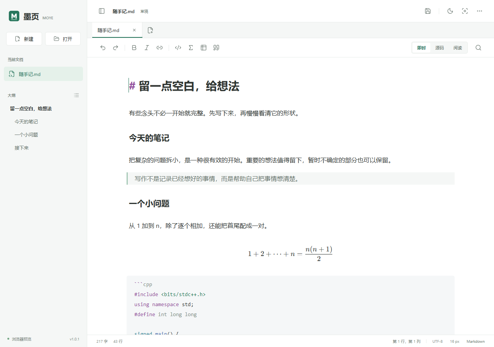
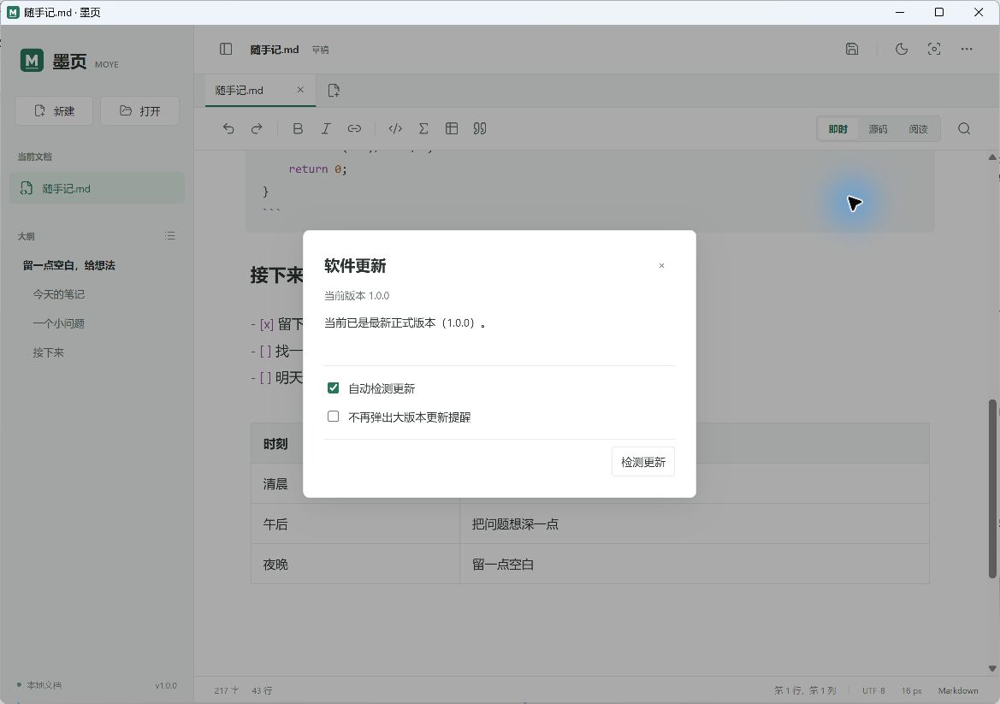

<div align="center">


# 墨页 Moye

**写中文，敲公式，记下一页好想法。**

一个离线优先的 Markdown 编辑器，为 Windows 与 macOS 打造。

[](https://github.com/SakuraEdge/moye-markdown/releases/latest)
[](https://github.com/SakuraEdge/moye-markdown/actions/workflows/build.yml)
[](LICENSE)

[下载 Windows 版](https://github.com/SakuraEdge/moye-markdown/releases/download/v1.0.5/Moye-Setup-1.0.5-windows-x64.exe) · [下载 macOS 版](https://github.com/SakuraEdge/moye-markdown/releases/download/v1.0.5/Moye-1.0.5-macos-universal.dmg) · [全部版本](https://github.com/SakuraEdge/moye-markdown/releases)

</div>



## 从 `/公式` 开始

在空白行输入 `/公式`，按回车，光标就落在公式块中间。
写下 `a^2+b^2=c^2`，离开这一行，公式立即排版。

不用记住每一种 Markdown 符号。`/代码`、`/表格`、`/待办`、`/引用` 都有中文提示，也支持拼音与英文前缀。中文输入法选词时，不会把确认回车当成插入命令。

从一份 [示例笔记](docs/写下一个好想法.md) 开始试写。

| 写作时需要的事 | 墨页如何完成 |
| --- | --- |
| 把注意力留在内容上 | 即时排版、专注模式、明暗主题与可调字号 |
| 公式和代码清晰可读 | KaTeX 数学公式、代码语法高亮、源码视图 |
| 同时整理几份笔记 | 多标签、独立撤销、未保存提示、整组草稿恢复 |
| 把成果分享出去 | 保存 `.md`，导出 A4 PDF 或独立 HTML |
| 留在自己的电脑里 | 原生文件读写，无账号、云同步或遥测 |
| 跟上新的正式版本 | 免登录检测，Windows 覆盖更新，大版本提醒可关闭 |

## 下载与安装

| 系统 | 推荐下载 | 其他方式 |
| --- | --- | --- |
| Windows 10 / 11，x64 | [安装程序 `.exe`](https://github.com/SakuraEdge/moye-markdown/releases/download/v1.0.5/Moye-Setup-1.0.5-windows-x64.exe) | [便携版 `.zip`](https://github.com/SakuraEdge/moye-markdown/releases/download/v1.0.5/Moye-1.0.5-windows-x64.zip) |
| macOS 13 Ventura 或更新版本 | [通用版 `.dmg`](https://github.com/SakuraEdge/moye-markdown/releases/download/v1.0.5/Moye-1.0.5-macos-universal.dmg) | [应用包 `.zip`](https://github.com/SakuraEdge/moye-markdown/releases/download/v1.0.5/Moye-1.0.5-macos-universal.zip) |

macOS 通用版同时包含 **Apple Silicon 与 Intel** 两种架构。校验和见 [SHA256SUMS](https://github.com/SakuraEdge/moye-markdown/releases/download/v1.0.5/SHA256SUMS-v1.0.5.txt)。

### Windows

运行安装程序，按提示完成安装。可以勾选 **“将墨页设为 .md 默认应用”**；安装完成后会打开 Windows 默认应用设置，由你确认关联。安装器不会绕过系统保护或强行改写其他应用的默认关联。

便携版请完整解压，再运行 `Moye.exe`，不要只移动 exe。发布包已包含 .NET 运行时，需要系统具备 Microsoft Edge WebView2 Runtime。

### macOS

打开 DMG，将 `Moye.app` 拖到 Applications。需要关联 Markdown 时，在 Finder 选中 `.md` 文件，使用“显示简介 → 打开方式 → Moye → 全部更改”。

**签名说明：** 当前开源发行包尚未使用 Windows 代码签名证书，也未完成 Apple Developer ID 签名与公证。系统可能在首次运行时要求你确认来源；请核对本仓库发布页和 SHA-256。macOS 使用本地临时签名以支持应用运行，不等于 Apple 身份认证。无需关闭系统安全保护。

## 三种视图，一份文件

- **即时**：标题、强调、引用、代码、块级公式和表格在编辑区排版，进入公式或表格时恢复源码。
- **源码**：行号、折叠与语法高亮，方便精确修改。
- **阅读**：完整预览，包括行内公式、图片和任务列表。
- **分屏**：左侧源码、右侧阅读，输入后实时更新，适合边改边校对。

新建、打开文档都会增加一个标签。切换时保留正文、光标、滚动位置和本次运行的撤销记录；关闭未保存文档前会询问。

v1.0.1 优化了标签悬停样式，选中指示条平滑滑动，正文轻量淡入。开启系统“减少动画”后会立即切换。

### 常用中文命令

| 输入 | 得到 |
| --- | --- |
| `/公式` / `/gongshi` / `/math` | `$$` 公式块，光标位于中间 |
| `/行内公式` | `$ $` |
| `/代码` | 代码围栏，默认 C++ |
| `/表格` | 两列表格 |
| `/待办` | 任务列表 |
| `/引用` | 引用块 |
| `/一级标题`、`/二级标题` | 对应层级标题 |
| `/分割线` | 分割线 |

输入 `/` 查看菜单；回车、Tab 或点击确认，Esc 关闭。路径、URL、普通段落和代码围栏内不会触发菜单。

## 保存和导出

点击右上角保存图标，选择 **Markdown** 或 **PDF**。已有 Markdown 文件使用 `Ctrl+S` / `⌘S` 直接保存；另存为可选择文件名与格式。

PDF 保留可选择的中文文字、数学公式、代码高亮、表格和本地相对图片，以 A4 页面排版。导出时切换标签，不会改变已提交的导出内容。

**PDF 是阅读副本。** 导出后，Markdown 源文档仍需单独保存；未保存提示不会消失。

“更多”菜单还可以导出独立 HTML，内嵌公式字体。相对图片保持原路径，分享时需同时携带图片文件。

## 更新与本地数据

“更多 → 检测更新”可随时检查 GitHub 正式版本。v1.0.2 起使用公开静态清单和备用下载地址，不占用 GitHub REST API 的匿名调用额度。自动检查在编辑器就绪后后台进行，每天最多一次；网络失败不会打断写作。有缓存时会显示上次成功检测的时间，不会把缓存当成当前最新结果。

主版本号变化才自动弹窗，例如 **`1.x → 2.x`**。同一主版本不会重复提醒，勾选“不再弹出大版本更新提醒”后会记住选择，手动检测仍然有效。

**Windows：** 点击“下载并覆盖更新”，应用校验安装包大小与 SHA-256，通过正常保存/退出流程后，在原目录运行安装程序。取消保存或下载就取消本次更新。安装器会覆盖同名程序文件，并清理文件清单中已废弃且未被改动的旧文件；草稿、文档、自行新增的文件及 `Data`、`Source`、`Backups` 目录不会被这项清理删除。下载缓存使用固定文件名，不按版本重复堆积。首次从旧版升级需手动下载一次本版安装器。

**macOS：** 下载新版 DMG，将 `Moye.app` 放入原来的 Applications 目录，选择替换。应用外的文档与草稿保留。

<details>
<summary>查看更新设置</summary>



</details>

编辑与导出可离线进行；只有更新检测会主动请求 GitHub，也可以关闭自动检测。不会上传文档内容。

| 数据 | Windows | macOS |
| --- | --- | --- |
| 标签与草稿 | `%LOCALAPPDATA%\Moye\session-v2.json` | `~/Library/Application Support/Moye/session-mac-v1.json` |
| 旧版迁移 | 自动迁移 v0.1 草稿，保留旧文件 | 首次发布，无旧版数据 |

Windows 可以将程序安装到其他磁盘。需要同时迁移草稿与 WebView2 偏好时，先退出应用，完整复制原数据目录并校验，再将当前用户注册表 `HKCU\Software\Moye\DataDirectory` 设置为新的绝对路径。开发测试可用 `MOYE_DATA_DIR` 环境变量覆盖；数据盘不可用时会报错，不会悄悄切换到空白目录。更新安装器会沿用程序安装路径。

草稿在停止输入后约 820 ms 备份，不会自动覆盖源文件；切换和关闭会同步最后输入。原生保存采用原子写入，保留 UTF-8 BOM、LF/CRLF，检测外部修改。崩溃仍可能丢失备份时间窗口内的输入，请定期保存重要文件。

## 快捷键

| 操作 | Windows | macOS |
| --- | --- | --- |
| 新建 / 打开 / 保存 | `Ctrl+N` / `Ctrl+O` / `Ctrl+S` | `⌘N` / `⌘O` / `⌘S` |
| 另存为 | `Ctrl+Shift+S` | `⌘⇧S` |
| 撤销 / 重做 | `Ctrl+Z` / `Ctrl+Y` | `⌘Z` / `⌘⇧Z` |
| 加粗 / 斜体 / 链接 | `Ctrl+B` / `Ctrl+I` / `Ctrl+K` | `⌘B` / `⌘I` / `⌘K` |
| 查找 | `Ctrl+F` | `⌘F` |
| 关闭标签 | `Ctrl+W` | `⌘W` |
| 切换标签 | `Ctrl+Tab` / `Ctrl+Shift+Tab` | `Control+Tab` / `Control+Shift+Tab` |

## 轻量，但不夸大

Windows 使用 WinForms + 系统 WebView2，macOS 使用 AppKit + 系统 WebKit。前端为 TypeScript + CodeMirror 6，不打包 Electron 或额外 Chromium。

**目前仍未完成稳定 1 秒内冷启动验收。** 实测口径、已有结果和下一步优化见 [性能记录](docs/performance.md)。不以窗口出现代替可编辑状态，也不承诺所有机器都能“秒开”。

目前仅支持 UTF-8 文本，打开上限 20 MB；网络图片默认不加载。即时模式中的行内公式与图片在阅读视图完整显示。暂不包含文件夹管理、Mermaid、插件或云同步。

## 开发与验证

开发入口、职责目录、消息约定与测试命令见 [开发导航](CODE_MAP.md)。源码现已按文档、编辑器、界面、宿主通信、导出和更新分类；可用 `npm run docs:map` 重新生成本地文件索引。

```bash
npm ci
npm run dev
npm test
npm run test:e2e
```

Windows 需 Node.js 24、.NET 8 SDK 和 WebView2；执行 `npm run package:win` 生成便携目录，安装器源码在 `installer/`。

macOS 需 Node.js 24 与 Xcode Command Line Tools：

```bash
npm run build
npx playwright install chromium
bash scripts/package-mac.sh
```

GitHub Actions 分别构建两个平台。macOS 原生检查会实际启动 WKWebView，检查多标签、公式、本地保存和多页 PDF；Windows 覆盖存储、更新协议与界面回归。详细记录见 [验证记录](docs/validation.md)。

发现问题？欢迎 [提交 Issue](https://github.com/SakuraEdge/moye-markdown/issues)，附上操作系统、版本与复现步骤。分享文档前请移除个人信息。

---

MIT License · 编辑体验受 Typora 启发，名称、图标与实现均独立。
