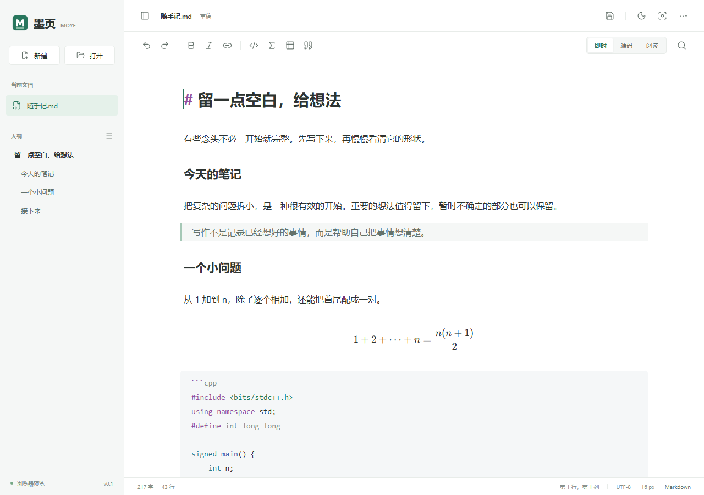

# 墨页 Moye

一个轻量、离线优先的 Windows Markdown 编辑器。参考 Typora 的即时排版体验，专门照顾中文写作、公式与代码。



## 使用

在本项目的 Releases 下载 `Moye-0.1.0-windows-x64.zip`，完整解压后运行 `Moye.exe`。不要只移动 exe；同目录的运行库和 `wwwroot` 都是程序的一部分。

- Windows 10/11 x64。发布包内置 .NET 运行时，无需安装 Node.js 或 .NET SDK。
- 需要 Microsoft Edge WebView2 Evergreen Runtime；程序会在缺少运行时时给出提示。
- 不联网也能编辑、渲染公式和高亮代码；没有账号、云同步或遥测。
- 可用 `Moye.exe "笔记.md"` 打开文件。重复启动会把请求交给已运行的窗口。

## 编辑

**即时**：标题、强调、引用、代码、块级公式和表格直接在编辑区排版；光标进入公式或表格时恢复源文本。

**源码**：行号、代码折叠、语法高亮。**阅读**：完整 Markdown 预览，包括任务列表、图片与行内公式。

在空白行输入 `/` 打开中文命令菜单。支持中文、拼音和英文前缀；回车、Tab 或点击确认，Esc 关闭。中文输入法的选词回车不会直接执行命令。

| 命令 | 插入内容 |
| --- | --- |
| `/公式`、`/gongshi`、`/math` | `$$` 块级公式，光标位于中间空行 |
| `/行内公式` | `$ $`，光标位于定界符内 |
| `/代码` | C++ 代码围栏，可修改语言名称 |
| `/表格` | 两列表格 |
| `/待办` | `- [ ] ` |
| `/引用` | `> ` |
| `/一级标题`、`/二级标题` | 对应标题 |
| `/分割线` | 分割线 |

路径、URL、普通段落和代码围栏内不会触发命令菜单。

## 文件与快捷键

原生打开、保存、另存为和关闭确认；保存采用同目录临时文件替换，保留 UTF-8 BOM 和 LF/CRLF，发现外部修改后询问是否覆盖。自动草稿位于 `%LOCALAPPDATA%/Moye/draft.json`，不会自动覆盖原始文件。

草稿在停止输入后约 820 ms 写入；崩溃时可能丢失最后这个时间窗口内的输入。正常关闭会先获取最后一份编辑内容再询问保存。单实例机制避免多个窗口争抢同一份草稿。

| 操作 | 快捷键 |
| --- | --- |
| 新建 / 打开 / 保存 | Ctrl+N / Ctrl+O / Ctrl+S |
| 另存为 | Ctrl+Shift+S |
| 撤销 / 重做 | Ctrl+Z / Ctrl+Y |
| 加粗 / 斜体 / 链接 | Ctrl+B / Ctrl+I / Ctrl+K |
| 查找与替换 | Ctrl+F |
| 专注模式 | Ctrl+Shift+F |
| 显示侧栏 | Ctrl+\ |
| 即时与源码切换 | Ctrl+/ |

更多菜单可导出独立 HTML，包含公式 CSS 与内嵌字体。文档中的相对图片路径保持原样；移动导出文件时应一起携带图片目录。

## 性能

Windows 原生 WinForms 窗口 + 系统 WebView2，不打包 Electron/Chromium。前端使用 TypeScript 和 CodeMirror 6，无 UI 框架；语言解析器按需加载。

实测数据、测量口径和复现命令见 [性能记录](docs/performance.md)。启动速度依赖机器、磁盘、杀毒扫描和 WebView2 状态，不承诺所有机器都在 1 秒内。

## 本地开发

需要 Node.js 24、.NET 8 SDK 和 WebView2 Runtime。

```powershell
npm ci
npm run dev
```

浏览器开发地址为 `http://127.0.0.1:4173`。浏览器模式保存为下载文件，不能覆盖原文件；它与桌面版的原生文件操作不同。

```powershell
npm run build
npm run desktop
npm run package:win
```

构建输出为 `release/Moye`。所有依赖版本记录于 `package-lock.json`。

## 验证

```powershell
npm test
npm run test:e2e
npm run test:native
```

浏览器端测试使用 Microsoft Edge。测试涵盖中文命令、模拟 IME 事件顺序、转义与 XSS、草稿恢复、撤销隔离、主题和窄窗口布局。存储测试覆盖中文路径、BOM、换行、外部修改、损坏草稿和原子替换。

模拟 IME 事件不是所有真实输入法的兼容性认证。发布前应继续检查微软拼音、搜狗等实际输入法。

## 范围

这是 v0.1：目前提供 Windows x64 桌面版；浏览器模式用于开发预览。尚未提供多标签、文件夹管理、PDF 导出、Mermaid、插件或云同步。即时模式的行内公式和图片在阅读视图中完整渲染。

文件采用严格 UTF-8，打开上限 20 MB。网络图片在桌面版默认不加载；本地相对图片只作为图片资源访问，不能通过预览脚本读取同目录文本文件。

## 结构

- `src/`：编辑器、中文命令、渲染、界面与宿主协议。
- `native/`：Windows 窗口、文件与草稿存储、单实例 IPC。
- `tests/`：Playwright 交互测试。
- `native-tests/`：独立存储检查。
- `scripts/benchmark.ps1`：隔离草稿目录的启动计时。

MIT License。编辑体验受 Typora 启发，本项目使用独立实现、独立名称与图标。
