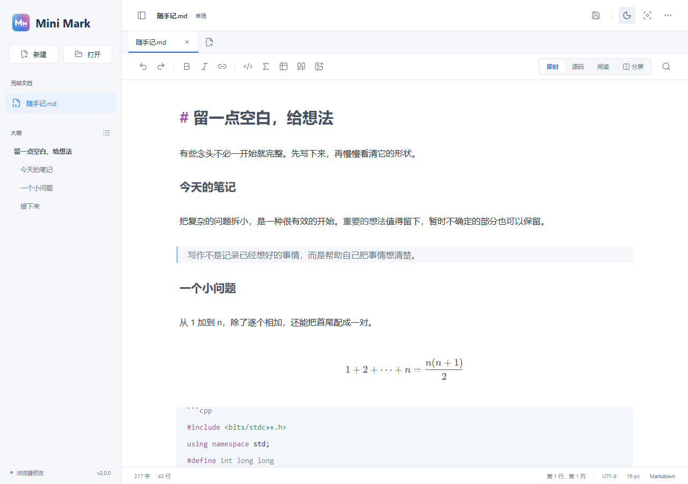

# Mini Mark

Markdown、YAML、HTML 编辑器，支持 Windows 和 macOS。

[下载正式版](https://github.com/SakuraEdge/mini-mark/releases/latest) · [版本记录](https://github.com/SakuraEdge/mini-mark/releases) · [反馈问题](https://github.com/SakuraEdge/mini-mark/issues)

## 编辑

| 功能 | |
| --- | --- |
| Markdown | 即时排版、源码、阅读、分屏；公式、表格、任务清单与大纲 |
| 多文档 | 独立标签、撤销记录和草稿恢复 |
| 中文命令 | 输入 `/公式`、`/代码`、`/表格` 插入对应内容 |
| YAML | 语法高亮，保留注释和缩进 |
| HTML | 编辑源码，在内置浏览器或本地 Chrome 中运行 |
| 图片 | 选择文件、拖入、粘贴或使用 HTTPS 图片网址 |
| 导出 | PDF 阅读副本、HTML 页面 |
| 插件 | 用 JavaScript 添加文字处理命令 |

支持亮色和深色主题。切换文档与主题带有过渡动画，遵循系统的“减少动画”设置。

## 云文档

Rev v1.0.0 新增 GitHub 云文档。本地编辑仍然不需要账号。

1. 点击侧栏底部的云文档按钮，登录自己的 GitHub 账号。
2. 连接账号下的 `MiniMarkDisk`。没有仓库时，确认创建私有仓库。
3. 浏览目录，打开文档，编辑后保存。也可新建文件夹分类。

本地文件不会自动上传。在保存菜单中选择“保存至云文档”，再选择目录和文件名。取消“云文档”开关后，当前文件恢复为本地文档，后续保存不再上传；云端原文件不会删除。

保存遇到云端修改冲突时，Mini Mark 会保留当前正文并停止覆盖。可以把修改另存为其他文件，或重新打开云端版本后合并。退出账号不会删除仓库和文档。

GitHub OAuth 授权会申请可读写私有仓库的 `repo` 权限。该权限本身不限于单一仓库，软件只操作当前账号的 `MiniMarkDisk`。登录凭据保存在 Windows 凭据管理器或 macOS 钥匙串，不写入文档。可在 GitHub 应用授权设置中撤销访问。

单个云文档上限为 **5 MB**。相对路径图片和 HTML 外部资源不会自动上传；云文档中插入的图片使用内嵌数据，也可使用 HTTPS 图片链接。

## 公式

在空白行输入 `/公式`，或点击工具栏公式按钮，打开公式编辑器。可使用分数、根号、上下标、积分和矩阵模板，也可直接输入 LaTeX。

- **写入 Markdown**：保存到当前 `$$` 公式块。
- **复制到 Word / WPS**：复制结构化公式。是否能直接粘贴为可编辑公式取决于接收软件的版本和粘贴方式。

## HTML、图片与插件

“更多 → 新建 HTML”创建网页。打开 HTML 只编辑源码，不自动执行；点击运行后，先保存，再打开预览。内置预览支持同目录及子目录中的 CSS、JavaScript、图片和字体。带后端服务的项目仍需自己的开发服务器。

本地文档插入的图片放在旁边的 `assets` 目录。分享时请携带资源文件。[图片说明](docs/images.md)

“更多 → 插件”可以导入或编写 `.js` 插件。插件支持处理选区、替换正文和展示结果，不开放网络或任意文件访问。[插件说明](docs/plugins.md)

## 安装

| 系统 | 安装包 |
| --- | --- |
| Windows 10 / 11，x64 | EXE 安装器，或完整解压 ZIP 后运行 `MiniMark.exe` |
| macOS 13 或更新版本 | DMG 或 ZIP，通用包支持 Apple Silicon 与 Intel |

从[正式版下载页](https://github.com/SakuraEdge/mini-mark/releases/latest)选择对应系统的文件。

Windows 安装时可以选择桌面和开始菜单快捷方式，以及 Markdown、YAML、HTML 文件关联。系统默认应用需要由 Windows 设置确认。三类文件使用独立文档图标，HTML 不会被强制设为默认应用。Windows 版需要 Microsoft Edge WebView2 Runtime。

macOS 将 `Mini Mark.app` 拖入 Applications。当前包使用 **ad-hoc 签名，未使用 Apple Developer ID，也未公证**。免费个人开发证书不等同于公开发行签名。Windows 包同样未使用商业代码签名。请从本仓库下载并核对校验和，无需关闭系统安全保护。

## 快捷键

| 操作 | Windows | macOS |
| --- | --- | --- |
| 新建 / 打开 / 保存 | `Ctrl+N` / `Ctrl+O` / `Ctrl+S` | `⌘N` / `⌘O` / `⌘S` |
| 另存为 | `Ctrl+Shift+S` | `⌘⇧S` |
| 查找 | `Ctrl+F` | `⌘F` |
| 切换标题等级 | `Ctrl+1` 至 `Ctrl+6` | `⌘1` 至 `⌘6` |
| 关闭标签 | `Ctrl+W` | `⌘W` |

同一标题快捷键再次按下，恢复普通正文。

## 保存与更新

本地文档支持 UTF-8 文本，打开上限为 20 MB。草稿恢复不替代正式保存；PDF 是阅读副本，导出后仍需保存源文件。

“更多 → 检测更新”可检查正式版本。Windows 支持下载并覆盖安装，沿用安装目录并保留文档和草稿。大版本提醒可关闭。

本地编辑可离线使用，没有遥测。GitHub 登录、云同步、更新检测和外链图片需要网络。暂不支持 Mermaid。

---

[提交问题](https://github.com/SakuraEdge/mini-mark/issues)时请附上系统、版本和复现步骤，分享示例前移除私人内容。

MIT License · 原名墨页 Moye
